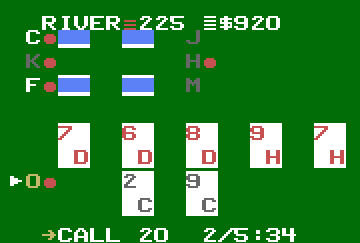
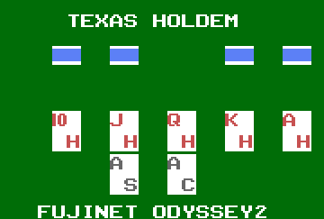
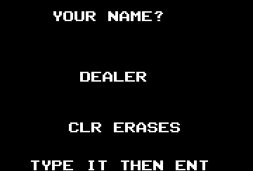
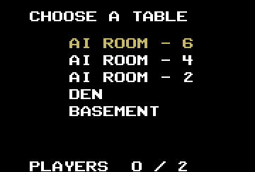
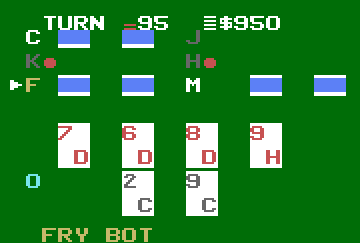
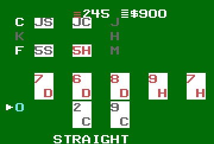
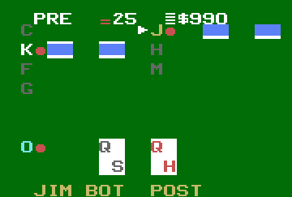
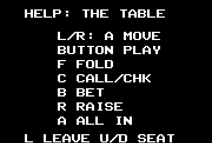

# Texas Hold'em for the Odyssey 2

Texas Hold'em for the Magnavox Odyssey 2 / Philips Videopac, over the
FujiNet O2 cartridge. It plays the same server as every other client: up to
eight seats, bots at the AI tables.

It is 8048 assembly (Macroassembler AS), built as a **protocol 2 (APPBANK)**
image: the fixed 1K at `$400-$7FF` holds the display engine, and seven 2K
pages at `$800` hold everything else. It needs firmware with APPBANK
(fujinet-firmware PR #2177).

It is fujinet-5cardstud's `o2/` (#19, #20) with a Hold'em table on it: the
same engine, build checks and test rig. Only tested in MAME
(`-cartslot fujinet`), never on a real console.

## Playing

| Where | Stick | Button | Keys |
|---|---|---|---|
| Name (first run) | | | letters, digits, space; CLR rubs out, ENT ends |
| Tables | up/down | sit down | |
| Your move | left/right picks | plays it | F fold, C check or call, B bet, R raise, A all in |
| Anywhere at the table | up/down: the spotlight | | L leaves |
| Anywhere but the name | | | H or ? shows the help; any key or the button goes back |

B and R play the smaller bet or raise; the stick reaches the bigger one. The
name is FujiNet's shared one (appkey creator 1, app 1, key 0).

## The screen



The whole table is one screen. The opponents sit two to a row in the top
four rows, each a letter and two cards, so all seven of an eight-seat table
show. Below them is the board, five cards two rows tall, and at the bottom
your hand, two cards two rows tall. The cards are the VDC's grid in fill
mode, white on green felt, with the rank and suit over them: red for hearts
and diamonds, near-black for spades and clubs, a blue block for a card face
down. T0 at the top has the street, the pot and your purse. T1 at the bottom
is your move menu and its clock on your turn, otherwise the seat in the
spotlight (whose turn it is, or the one you picked) and what it did last,
and between hands the result.

A seat's letter is tan when it is to move, grey when it has folded or is
out (its cards gone), cyan for you. The spotlight is an arrow left of its
seat's letter. A red ball right of a letter is a chip: that seat has a bet
in this street. In T0 a stack of chips sits by the pot and by your purse,
one to four high (from 1, 25, 100, 250).

### Screenshots

From MAME, against a private server:

| | | |
|---|---|---|
|  |  |  |
| The title | Your name, the first time | The tables |
|  |  |  |
| Your move on the river: call 20, 2 of 5, 34 seconds; C and F have bet | Fry to move on the turn | The showdown: C's jacks and F's fives up; F (Fry) won with a straight |
|  |  | |
| Eight seats: seven opponents, four rows | Help (H or ?) | |

### How it's drawn

`src/fixed.inc` re-points the 12 single characters between rows from a
line-counter interrupt: Battleship's engine, which was M.U.L.E.'s, as 5 Card
Stud has it. Every screen is T0 (the four quads, written in the vblank),
eight rows of 11 singles at Y 30 + 24r (one per grid row), and T1 (the quads
again). A text screen is the same rows on black, the singles side by side.

Every row is the same 11 singles at the same X: a letter, then five places
of rank and suit over grid columns 1, 3, 5, 7 and 9. An opponents' row uses
places 0-1 for the left seat's cards, place 2 (its cell left bare) for the
right seat's letter and chip, and places 3-4 for its cards. The board and
the hand are the same five places, the rank on the top row and the suit on
the bottom; their bottom rows' bands (`h_row2`) leave the cards on, so a
card is two grid rows tall.

What fits, measured in MAME (`make spike`, `make shot`):

- **A row is 11 characters**, as in 5 Card Stud: a band writes Y, pointer
  and control, 15 cycles a character, in the 10 lines between two rows, then
  sprite 1's Y. `PADN` 2 holds, 3 cuts the tops of a row's characters.
- **One chip sprite.** Sprite 1 goes down the rows as each band writes it:
  the left seats' chips and yours. A second sprite for the right seats cost
  the band its slack (`PADN` 0 held, 1 cut), so a right seat's chip is the
  font's ball, a character in place 2, and sprite 1 is drawn as the same
  ball. The arrow and the two stacks stay where the vblank puts them.
- **The gap between two rows of cards** is the grid switched off for 3 lines
  across the grid's row boundary, from inside the row write (`SEPA`,
  `SEPB`), each write placed so that it lands in the horizontal blank.
  `tools/rowcheck.py` finds no frame that differs.

**A state's pass.** The main loop reads the keys once a pass, so a pass has
to be short for a quick press to be seen. Every state, each row's signature
is worked out from the reply and only the rows that changed are drawn. A
seat's 33 bytes are read through one mailbox window (`rx_winr`, `rx_get`),
not a window per byte, and T0 and T1 are rewritten only when what they show
has changed (`T0SIG`, `T1SIG`). Timed with o2sim's taps at `ai6`, a pass is
4-5 frames, and 7-16 when rows are redrawn (5 Card Stud's #20 under the same
measure: 8, and 13-21).

## Building

```
make                                  # build/texas.bin, the live server
make ENDPOINT=http://localhost:8083/  # another server
make spike                            # the engine's test pattern
make run                              # MAME, in a window (run.sh)
```

The build needs `~/asl/asl` and `p2bin` (`ASL=`, `P2BIN=`). After assembling
each page, `build.sh` runs the checks, each for a fault that is silent at run
time: `checkflags` (a JZ testing a MOV), `checkobj` and `checklayout`
(overlaps), `checkmb` (a cross-bank call with no restore), `checkpage` (a
MOVP table outside the page the MOVP runs in), `checkstack` (the 8-level
stack). It also checks the fixed half is the same in every page.
`tools/pageends.py` shows how full each page's sections are.

### Pages

| Page | |
|---|---|
| 0 | boot: cart check, name from the appkey, the table list, join |
| 1 | the network: CLOSE, OPEN, STATUS until settled, READ; one step a frame |
| 2 | the main loop: keys, stick, polls, dispatch |
| 3 | a state: the header, the spotlight's arrow, the rows that changed; the title |
| 4 | every frame: the move menu, the clock, the spotlight, the result's pages |
| 5 | help, and name entry |
| 6 | a state, after page 3: our moves, T0 and its stacks, T1, the sounds, the chips |

A state is taken only if its length is `165 + 33n`, and the table list only
if it is `1 + 36n`. A move's amount is kept in BCD, so the menu shows four
digits ("CALL 1250").

## Testing

Everything runs headless in MAME through `tools/o2sim.py`. `test/rig.sh`
builds and starts the server from `~/Workspace/servers/fujinet-game-system/
texasholdem/server` on port 8083 (`-disable-lobby`) and a private
fujinet-pc-rs232 on BoIP 19978, with the name appkey seeded; it refuses an
image not built for it.

```
make shot      # the spike: snapshots + tools/rowcheck.py
make test      # boot, the table, help, leaving, name entry
make soak      # an AUTOPLAY build plays the AI table with six bots
make eight     # ... the hidden dev7 table: eight seats
make two       # ... against test/player.py at The Basement: two humans
```

What has run, all in MAME against the private server: boot, name entry,
the table list, join, help, leave; AUTOPLAY hands at `ai6` through every
street to the showdown and on, every request a 200; eight seats and the
spotlight round all of them; three hands against a second human; `rowcheck`
steady while the game runs.

## Not done

- **Lobby handoff (appkey key 5).** There is no O2 lobby.
- **PAL.** The band timing is NTSC's.
- **Real hardware.** T0 at line 16, T1 at line 228 and the spotlight's
  arrow at the left edge may sit in a TV's overscan.
